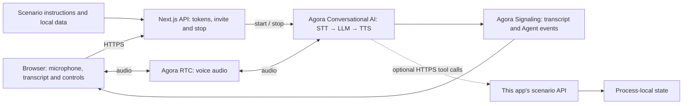

# Travel Itinerary Support

Review an itinerary and request a change after identity and confirmation.

[Try locally](#2-try-the-demo) · [Source on GitHub](https://github.com/littleDogWang/10-travel-booking) · [Build with AI](#build-with-ai)

TypeScript · Web · Next.js 16 / React 19 · Agora Conversational AI

## 1. Overview

A voice itinerary assistant for a fictional New York (JFK) to Los Angeles (LAX) order. It checks the exact order and traveler key before disclosing details, explains the departure in its configured time zone, and can record a change or cancellation request when tools are enabled.

- Order-and-traveler matching before itinerary disclosure.
- Explicit confirmation before a supported change or cancellation request.
- Request IDs for replay handling, with requested status distinguished from a completed transport-system action.

**Default conversation:** The prompt contains fixed fictional orders. Matching identity permits itinerary discussion, but the assistant cannot update records or submit a request.

**With business tools enabled:** `lookup_travel_order` reads a matching order; `update_travel_order` records a confirmed request in process memory. Failed tools cannot fall back to inline order data.

**Scope:** `change_requested` and `cancel_requested` are request states, not a completed ticket change, cancellation or refund. No airline schedule, fare, seat inventory, payment or live traveler-authentication system is connected.

## 2. Try the Demo

Run [Quick Start](#5-quick-start), open [http://localhost:3000](http://localhost:3000), allow microphone access and choose **Review travel plans**. A voice session starts only after your action. The Agora project must be configured even in default conversation mode; “local data” does not mean offline speech or a local LLM.

| Try | Say | Expected behavior |
| --- | --- | --- |
| Review a fixture itinerary | Please review order TRAVEL-1001. My traveler key is traveler-1. | After matching both fields, it describes the fictional JFK–LAX itinerary and Eastern departure time. |
| Request the listed alternative | What change is available? Please read it back before I confirm. | In tool mode, it offers only the configured alternative and records a request after confirmation. |
| Fail identity matching | Review TRAVEL-1001 with traveler key wrong-key. | It withholds itinerary details and does not reveal the correct key to help the caller match. |

Rows that describe tool actions require the optional public HTTPS tool configuration. In default mode, expect the limitations described above. These are acceptance cases to try, not a claim that a live voice run has passed. For the full scenario matrix, see [acceptance.md](docs/scenario/acceptance.md).

## 3. Architecture & Tech Stack



| Component | Role |
| --- | --- |
| Agora RTC | Carries user microphone audio and synthesized Agent speech. |
| Agora Signaling (RTM) | Delivers transcript, Agent state, metrics and error events to the browser. |
| Agora Conversational AI | Runs the managed voice pipeline and configured business tools. |
| Next.js route handlers | Keep the App Certificate server-side, issue combined RTC/RTM tokens and manage Agent sessions. |
| Scenario modules | Supply instructions, demo data and the optional business API/tool contracts. |

The client uses `agora-rtc-react`, `agora-rtc-sdk-ng`, `agora-rtm` and `agora-agent-client-toolkit`; the server uses `agora-agents`. The configured pipeline is Deepgram nova-3 → OpenAI gpt-4o-mini → MiniMax speech_2_6_turbo with English speech. See [the invite route](app/api/invite-agent/route.ts) and [runtime profile](lib/runtime-profile.ts) when changing providers. No separate vendor API key is required for the default Agora-managed configuration.

## 4. Prerequisites & Configuration

- Node.js 22 or newer and pnpm 9.15.9.
- An Agora project with its App Certificate enabled, and access to RTC, Signaling and Conversational AI.
- Access to this repository. Cloning or sharing the source requires appropriate repository permissions.
- A browser with microphone access; use HTTPS for a hosted app.

| Variable | Required? | Where / purpose |
| --- | --- | --- |
| `NEXT_PUBLIC_AGORA_APP_ID` | Required | App ID from your Agora Console project. |
| `NEXT_AGORA_APP_CERTIFICATE` | Required | App Certificate from the same project; server-side only. |
| `TOP_TEN_SCENARIO_TOOL_BASE_URL` | Optional | Public HTTPS origin of this same app, reachable by Agora cloud; enables the business tools described below. |

Create or select your project in [Agora Console](https://console.agora.io/), copy the App ID and enable/copy its App Certificate. Put them in `.env.local` using [env.local.example](env.local.example). Never prefix the certificate with `NEXT_PUBLIC_`, put it in client code or commit it.

Leave `TOP_TEN_SCENARIO_TOOL_BASE_URL` unset for the default conversation. To enable tools, deploy the same app at a reachable public HTTPS origin, set that variable on the server, restart/redeploy and start a fresh conversation. HTTP, localhost/private origins, malformed URLs and URLs with credentials, query or fragment are rejected. URL validation does not establish actual cloud reachability. In tool mode, a failed call must not be disguised as a successful fixture-based action.

## 5. Quick Start

From a terminal, clone this scenario rather than the generic starter:

```bash
git clone https://github.com/littleDogWang/10-travel-booking.git
cd 10-travel-booking
pnpm install --frozen-lockfile
cp env.local.example .env.local
```

Edit `.env.local` and fill the two required Agora values from section 4. Then run these commands from the cloned repository root:

```bash
pnpm run doctor
pnpm run dev
```

Alternatively, if the [Agora CLI](https://github.com/AgoraIO/cli) is already installed, bind your project with `agora login`, `agora quickstart env write . --template nextjs --project <your-project> --json` instead of manually copying credentials. Use your actual project identifier in place of `<your-project>`.

Open [http://localhost:3000](http://localhost:3000), choose **Review travel plans**, allow the microphone and try the first conversation above. Check that you can hear the assistant and see both speakers in the transcript. Then verify the scenario result under the configured mode; a transcript alone does not establish that a business action occurred.

## 6. How It Works

| User step | Assistant / application behavior | Result |
| --- | --- | --- |
| Supply the order ID and traveler key | Require matching identity before disclosing the itinerary. | A matching fixture itinerary or an unresolved identity error. |
| Ask for a change or cancellation | Explain the supported option and ask for explicit confirmation. | A confirmed request intent, not a completed ticket operation. |
| Confirm the action | Call update_travel_order with a request ID and report the returned state. | change_requested or cancel_requested; failure remains a failure. |

### Tools and result semantics

`lookup_travel_order` calls `GET /api/scenarios/10-travel-booking/orders` with `order_id` and `traveler_key`. `update_travel_order` posts the identity, action, request_id and confirmed=true, plus an allowed new_departure for a change. The fixture's original departure is November 5, 2026 at 09:00 EST; its listed change is November 6 at 09:00 EST. These dates do not roll forward.

The invite body contains `requester_id` and `channel_name`. The supplied browser already handles this startup sequence. See [the scenario guide](docs/scenario/README.md) for additional behavior and contracts.

## 7. Customize for Your Business

| Change | Source | How |
| --- | --- | --- |
| Itineraries and allowed alternatives | [travel.json](lib/travel-booking/travel.json) | Replace orders, traveler test keys, departure dates, departureTimeZone and availableChanges. |
| Lookup and request rules | [travel.ts](lib/travel-booking/travel.ts) | Adapt identity lookup, request handling and storage; do not expose traveler test keys as real authentication. |
| Conversation | [config.ts](lib/agent-config.ts) | Change itinerary guidance and confirmation language; lib/agent-config.ts controls inline-data versus tool-only prompts. |

To use a travel provider, replace the fixture lookup and request handler with authorized provider calls and a durable request store. Preserve a pending/requested state until the provider confirms completion. Test identity failure, an unsupported alternative and repeated requests; never infer a refund from a cancellation request.

Shared integration points:

- [lib/agent-config.ts](lib/agent-config.ts) assembles the selected scenario prompt.
- [lib/agent-tools.ts](lib/agent-tools.ts) defines business tool schemas and server-bound routes.
- [app/api/invite-agent/route.ts](app/api/invite-agent/route.ts) selects the prompt, providers, turn detection and session settings.
- [lib/presentation.ts](lib/presentation.ts) selects the scenario presentation; edit its scenario module for visible content.
- [docs/ai/RECIPE.md](docs/ai/RECIPE.md) retains the machine-readable integration profile and lifecycle contracts.

Keep combined RTC/RTM token generation, the StrictMode initialization guard, toolkit local-user UID remapping and interrupted transcript turns intact. Let the Agora React hooks own microphone and RTC teardown. Preserve server-bound business session scope when extending tools.

### Build with AI

After cloning this repository, paste the following into your coding agent from your own application workspace, providing the path to the clone:

```text
Implement the Travel Itinerary Support recipe in my application.

Read RECIPE.md in the cloned 10-travel-booking repository first, then inspect
its scenario modules, tool contracts and invite route. Read docs/ai/RECIPE.md
and AGENTS.md in that repository for integration constraints.

Inspect my application's existing stack and instructions before editing.
Reuse the source's RTC/RTM token, session and transcript patterns.
Implement the scenario's default conversation first, then connect only the
business tools I request. Keep demo data and real service results distinct.
Explain the credentials and configuration I need to supply.
Ask before adding dependencies. Follow my rules for local edits, verification,
commits and remote writes. Verify the result without claiming unrun live tests.
```

This prompt is a source-guided integration entry point, not a published scaffolding package or an automatic Console import.

## 8. Deployment & Validation

### Deploy

Tool-mode orders and replay records live in process-local Maps. Use one long-lived Node process for a consistent demo; restart resets state. Shared durable storage and real traveler authorization are required before multi-instance or real booking-system use.

Install dependencies and set the same required environment variables in your deployment platform's secret store. Build with `pnpm run build` and, on a Node host, start with `pnpm run start`. Keep the public app on HTTPS. For voice tools, set `TOP_TEN_SCENARIO_TOOL_BASE_URL` to the deployed app's reachable HTTPS origin and verify cloud callbacks against that same running instance.

These commands describe the repository's supported scripts; they do not attest to an existing deployment. Before opening sample endpoints to real users, add application authentication, authorization and appropriate request limits.

### Docker deployment

```bash
docker build --build-arg NEXT_PUBLIC_AGORA_APP_ID=YOUR_AGORA_APP_ID -t 10-travel-booking:local .
docker run --rm -p 3000:3000 --env-file .env.local 10-travel-booking:local
```

Replace `YOUR_AGORA_APP_ID` with the public App ID used in `.env.local`. Next.js embeds that identifier in the browser bundle, so changing projects requires rebuilding the image. The App Certificate is supplied only at container runtime. A container restart does not preserve process memory. This image does not add a shared state service.

`pnpm run verify:docker` independently builds the image with synthetic credentials, starts an isolated localhost-bound container, checks the home page and a scenario route, then removes only that container. It does not contact Agora or prove a live voice session.

### Check locally

From this repository root:

```bash
pnpm run verify:template
pnpm run lint
pnpm run typecheck
pnpm run verify:api
pnpm run verify:scenario
pnpm run build
```

With the local prerequisites and credentials configured, also run `pnpm run verify`. The canonical verify script includes all of the local scenario checks above; Docker is deliberately verified separately. Local checks do not require a real microphone call and do not prove cloud tool execution.

### Verify a real conversation

1. Start a fresh voice session; check two-way audio and both transcript speakers.
2. Try the normal, correction and unsupported/failure paths in section 2.
3. Test correct and incorrect traveler keys, the listed change, an unavailable change and a cancellation request. Inspect the returned requested state. Start a fresh server if you need the original fixed order again.
4. End the call and confirm that microphone publication and the Agent session stop. Keep evidence of the actual result separately from the transcript.

### Troubleshooting

| Symptom | Check |
| --- | --- |
| Agent does not join | Check the token/invite response and run pnpm run doctor. If using the Agora CLI, run agora project doctor --deep. |
| Audio works but transcript is missing | Check RTM login/subscription and keep RtcTokenBuilder.buildTokenWithRtm in the token route. |
| Browser has no microphone | Grant permission, select an input device and use localhost or a secure HTTPS page. |
| The assistant discusses the task but does not save or change it | Check whether the optional public tool origin is enabled. The default conversation has the limits in section 1. |
| A tool fails or a result disappears | Inspect the actual API error, callback reachability and this scenario's storage/lifetime limits; do not claim success from speech alone. |

See [the contributor guide](AGENTS.md), [scenario guide](docs/scenario/README.md) and [MIT License](LICENSE) for further details.
